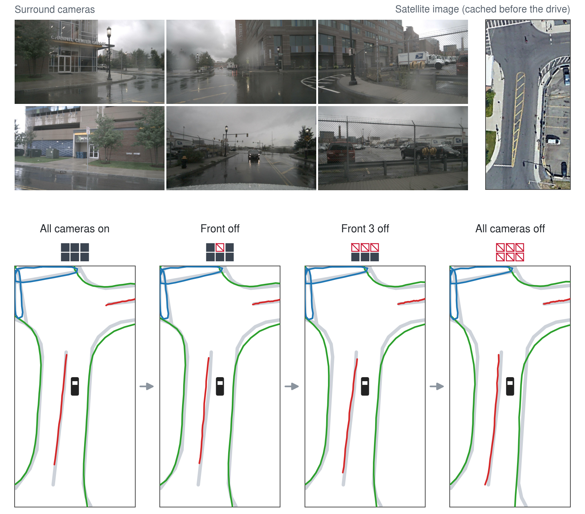
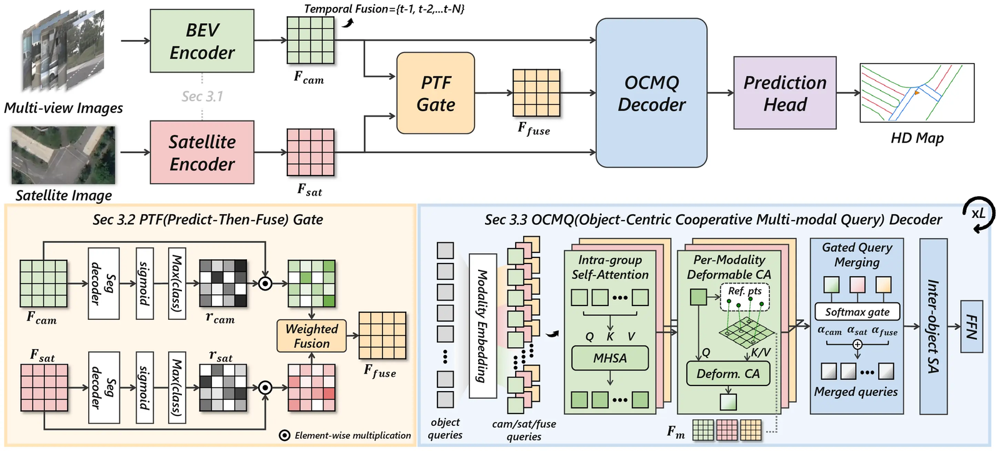
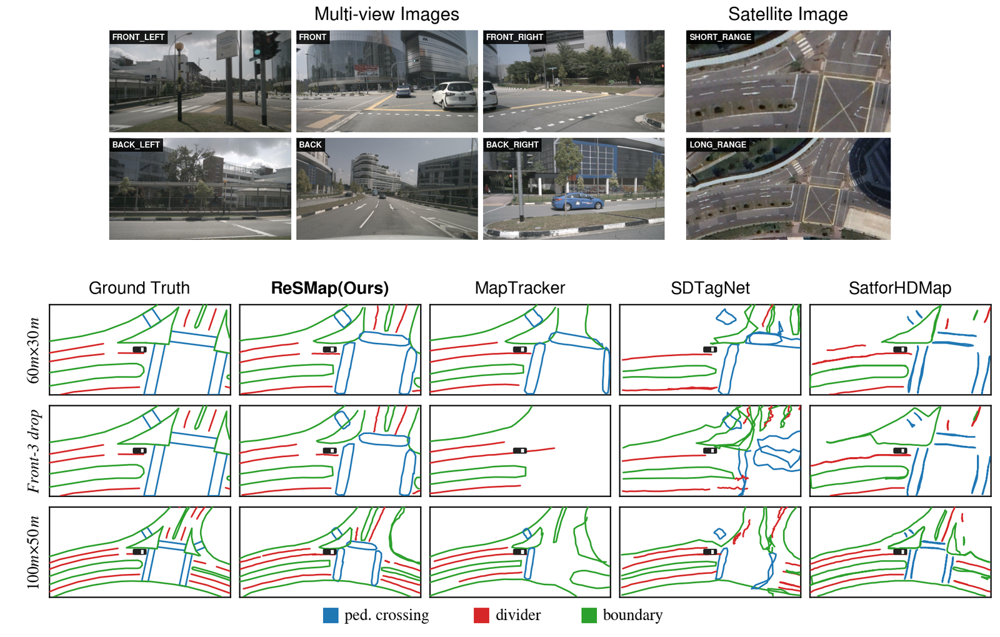

# ReSMap: Recasting Satellite Priors for Robust and Accurate Online HD Map Construction

> Kyungmin Kim<sup>\*</sup>, Sumin Lee<sup>\*</sup>, Sungoh Jeong, DoHyun Lim, Seonghyun Park, Soonmin Hwang<sup>&dagger;</sup>

> [IRCV Lab](https://ircv.hanyang.ac.kr), Hanyang University &nbsp;&nbsp; <sup>\*</sup> Equal contribution &nbsp;&nbsp; <sup>&dagger;</sup> Corresponding author

## [](https://neurips.cc/virtual/2026/loc/sydney/poster/149564) [](https://dehsurc.github.io/resmap-page/)

## News

- `2026.10.13` Training and evaluation code and the checkpoint are released.
- `2026.09.28` ReSMap is accepted to **NeurIPS 2026**. 🎉

## Introduction
Camera-based online HD map construction fails when the onboard cameras do. Satellite images, in contrast,
are cached before the drive and stay available regardless of real-time sensing conditions. We introduce
ReSMap, a redundancy-aware camera–satellite fusion framework that uses the satellite image not only as a
strong prior but as practical redundancy, and achieves state-of-the-art online HD map construction on
nuScenes both with clean inputs and under camera failure. For more details, please visit our
[project page](https://dehsurc.github.io/resmap-page/).
<div align="center">
  
</div>

ReSMap on one frame as the cameras fail one after another: ReSMap predictions in color over the ground
truth in grey, with the ego vehicle at the center facing up.<br/>

## Overview
ReSMap encodes the multi-view images into a camera BEV feature with a temporal BEV encoder, and the
ego-aligned satellite image into a satellite BEV feature on the same grid. The **Predict-then-Fuse (PTF)**
gate runs a segmentation decoder on each branch and fuses the two BEV features using each branch's own
per-pixel prediction confidence as its weight, with no learned router, so a failed camera hands its weight
to the satellite branch. The **Object-Centric Cooperative Multi-modal Query (OCMQ)** decoder keeps one pool
of object queries: in each layer every query attends to the camera, satellite and fused BEV through its own
modality copy, and a learned per-token gate merges the three updates.
<div align="center">
  
</div><br/>

## Prepare
- [Installation](docs/installation.md)
- [Dataset](docs/data_preparation.md)

## Train and Test
### Train ReSMap
ReSMap is trained in three stages (6 + 6 + 12 epochs) with a total batch size of 6. The configs set
`data.samples_per_gpu=3`; keep the total batch size at 6 for other GPU counts (e.g.
`--cfg-options data.samples_per_gpu=2` on 3 GPUs).
```shell
cd /path/to/ReSMap
conda activate resmap
# stage 1: camera / satellite encoders and BEV segmentation heads with PTF
bash tools/scripts/dist_train.sh configs/resmap_stage1.py ${NUM_GPUS}
# stage 2: OCMQ decoder on the frozen stage-1 model
bash tools/scripts/dist_train.sh configs/resmap_stage2.py ${NUM_GPUS}
# stage 3: all modules, from the best stage-2 checkpoint
bash tools/scripts/dist_train.sh configs/resmap_stage3.py ${NUM_GPUS} \
    --cfg-options load_from=work_dirs/resmap_stage2/best_mAP_iter_27840.pth
```
`bash tools/scripts/train_resmap.sh ${NUM_GPUS}` runs the three stages in a row. If NCCL hangs at
start-up, set `NCCL_P2P_DISABLE=1`.

### Eval ReSMap
```shell
cd /path/to/ReSMap
conda activate resmap
python tools/test.py configs/resmap_stage3.py /path/to/ckpt.pth
```
The released checkpoint (`resmap_nusc_newsplit_60x30.pth`, [OneDrive](https://1drv.ms/u/c/f9ca6528653ff6e7/IQDWeAojcYZcQ7biInP4larvAfizIC6LzntE6_j5A5Ll8BY)) reproduces the results below.

### Eval under camera failure
`--camera-drop` zeroes cameras at test time and keeps the satellite image: `front1` (CAM_FRONT), `front3`
(the three front cameras) or `all` (all six cameras).
```shell
python tools/test.py configs/resmap_stage3.py /path/to/ckpt.pth --camera-drop front3
```
To evaluate all four settings (all cameras working, Front-1, Front-3 and All off) and print a summary
table:
```shell
bash tools/scripts/eval_camera_drop.sh configs/resmap_stage3.py /path/to/ckpt.pth ${NUM_GPUS}
```

## Results
| Model | Dataset | Range | Config | Checkpoint |
| --- | --- | --- | --- | --- |
| ReSMap | nuScenes (geographically non-overlapping split) | 60 m × 30 m | [config](configs/resmap_stage3.py) | [OneDrive](https://1drv.ms/u/c/f9ca6528653ff6e7/IQDWeAojcYZcQ7biInP4larvAfizIC6LzntE6_j5A5Ll8BY) |

### nuScenes geographically non-overlapping split, 60 m × 30 m
The same checkpoint evaluated with all cameras working and under camera failure. AP is averaged over
Chamfer thresholds {0.5, 1.0, 1.5} m.

| Cameras | AP<sub>ped</sub> | AP<sub>div</sub> | AP<sub>bound</sub> | mAP |
| --- | --- | --- | --- | --- |
| All six working | 69.5 | 36.6 | 58.7 | 54.9 |
| Front camera off | 66.2 | 32.8 | 52.0 | 50.3 |
| Three front cameras off | 61.5 | 29.5 | 44.4 | 45.1 |
| All six cameras off | 55.3 | 17.6 | 25.7 | 32.9 |

## Visualization
Qualitative comparison on the nuScenes geographically non-overlapping split (Fig. 4 of the paper). Rows:
60 m × 30 m with all cameras working, 60 m × 30 m with the three front cameras off, and 100 m × 50 m with
all cameras working.
More examples, including an interactive viewer, are on the [project page](https://dehsurc.github.io/resmap-page/).

<div align="center">
  
</div>

Satellite imagery: Google Earth, via AID4AD.

## Citation
If this work is helpful for your research, please consider citing the following BibTeX entry.

```bibtex
@inproceedings{kim2026resmap,
  title={ReSMap: Recasting Satellite Priors for Robust and Accurate Online HD Map Construction},
  author={Kyungmin Kim and Sumin Lee and Sungoh Jeong and DoHyun Lim and Seonghyun Park and Soonmin Hwang},
  booktitle={Advances in Neural Information Processing Systems (NeurIPS)},
  year={2026}
}
```

## License
This repository is built upon MapTracker and follows its license: GPLv3, non-commercial use only (see
[LICENSE](LICENSE)). nuScenes and AID4AD are released under CC BY-NC-SA 4.0, and the AID4AD aerial imagery
is subject to the Google Earth Terms of Service; this repository does not redistribute it.

## Acknowledgement
ReSMap is based on the following projects: [MapTracker](https://github.com/woodfrog/maptracker),
[StreamMapNet](https://github.com/yuantianyuan01/StreamMapNet), [MapTR](https://github.com/hustvl/MapTR),
[BEVFormer](https://github.com/fundamentalvision/BEVFormer) and
[AID4AD](https://github.com/DriverlessMobility/AID4AD). Many thanks for their excellent contributions to the
community.
